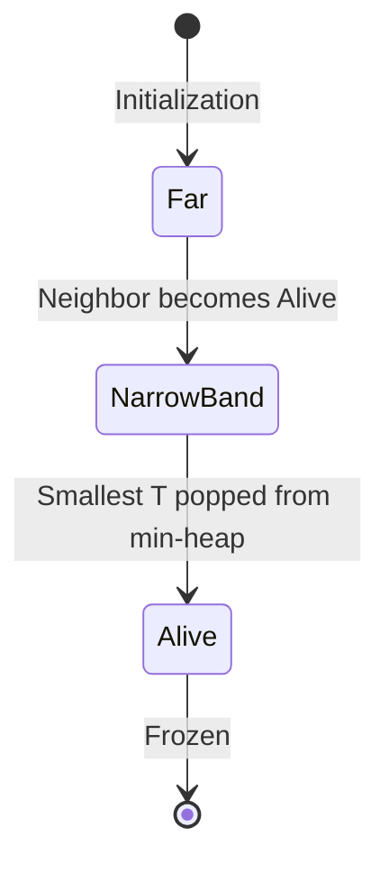

# Numerical & Physical Theory

This document outlines the mathematical formulation, numerical approximations, and algorithms implemented in `seiscode-eikonal`.

---

## 1. The Eikonal Equation

The traveltime $T(\mathbf{x})$ of a high-frequency wavefront in an isotropic acoustic/elastic medium satisfies the Eikonal equation:

$$|\nabla T(\mathbf{x})| = s(\mathbf{x}) = \frac{1}{v(\mathbf{x})}$$

where:
- $\mathbf{x} = (x, z)$ represents spatial coordinates,
- $v(\mathbf{x}) > 0$ is the medium wave velocity,
- $s(\mathbf{x}) > 0$ is the slowness (refractive index).

In 2D Cartesian coordinates:

$$\left(\frac{\partial T}{\partial x}\right)^2 + \left(\frac{\partial T}{\partial z}\right)^2 = s^2(x, z)$$

The solution $T(x, z)$ represents the **first-arrival traveltime** from the source point $\mathbf{x}_s$ to any point in the domain.

---

## 2. Upwind Finite Difference Stencils

To compute first arrivals causally, characteristics (rays) propagate outwards from smaller traveltimes to larger traveltimes. The spatial derivatives are discretized using **upwind** finite differences.

Let $T_{i, k} = T(x_0 + i \cdot dx, z_0 + k \cdot dz)$.

### First-Order Upwind Stencil (`order=1`)

The standard one-sided backward difference in $x$ is:

$$D_x^- T_{i, k} = \frac{T_{i, k} - T_{i-1, k}}{dx}$$

and forward difference is:

$$D_x^+ T_{i, k} = \frac{T_{i+1, k} - T_{i, k}}{dx}$$

The upwind approximation selects the causal minimum from accepted neighbor values:

$$D_x T_{i, k} \approx \frac{T_{i, k} - T_x^{\min}}{dx}, \quad \text{where } T_x^{\min} = \min(T_{i-1, k}, T_{i+1, k})$$

Similarly in $z$:

$$D_z T_{i, k} \approx \frac{T_{i, k} - T_z^{\min}}{dz}, \quad \text{where } T_z^{\min} = \min(T_{i, k-1}, T_{i, k+1})$$

Substituting into the Eikonal equation yields a quadratic equation for the unknown candidate time $T$:

$$\left( \max\left(\frac{T - T_x^{\min}}{dx}, 0\right) \right)^2 + \left( \max\left(\frac{T - T_z^{\min}}{dz}, 0\right) \right)^2 = s_{i, k}^2$$

#### Quadratic Solution:
1. **2D Update (Both directions active)**:
   If the wavefront reaches $(i, k)$ obliquely:
   $$\frac{(T - T_x^{\min})^2}{dx^2} + \frac{(T - T_z^{\min})^2}{dz^2} = s_{i, k}^2$$
   Let $a = \frac{1}{dx^2} + \frac{1}{dz^2}$, $b = -2\left(\frac{T_x^{\min}}{dx^2} + \frac{T_z^{\min}}{dz^2}\right)$, $c = \frac{(T_x^{\min})^2}{dx^2} + \frac{(T_z^{\min})^2}{dz^2} - s_{i, k}^2$.
   The candidate time is:
   $$T = \frac{-b + \sqrt{b^2 - 4ac}}{2a}$$
   This 2D solution is valid if and only if $T > T_x^{\min}$ and $T > T_z^{\min}$.

2. **1D Update (One direction active / grazing)**:
   If the discriminant $\Delta = b^2 - 4ac < 0$ or if the 2D condition fails, the wave arrives along a coordinate axis:
   $$T = \min\left( T_x^{\min} + s_{i, k} \cdot dx, \; T_z^{\min} + s_{i, k} \cdot dz \right)$$

---

### Second-Order Upwind Stencil (`order=2`)

First-order FMM exhibits geometric diamond-shaped grid anisotropy with relative errors reaching ~3–5% along grid diagonals. Second-order finite differences substantially eliminate this error (< 0.5%).

The 2nd-order backward difference operator using two upstream points is:

$$D_x^{2-} T_{i, k} = \frac{3 T_{i, k} - 4 T_{i-1, k} + T_{i-2, k}}{2 dx} = \frac{T_{i, k} - T_{x, 2}^{\min}}{\frac{2}{3} dx}$$

where the effective virtual upstream time is:
$$T_{x, 2}^{\min} = \frac{4 T_{i-1, k} - T_{i-2, k}}{3}$$

#### Automatic Fallback Strategy:
A 2nd-order update along direction $x$ requires that:
1. Both nodes $(i-1, k)$ and $(i-2, k)$ are `Alive` (already computed).
2. The monotonicity condition holds: $T_{i-1, k} > T_{i-2, k}$.
3. The virtual time satisfies causality: $T > T_{x, 2}^{\min}$.

If any condition is violated or if near the domain boundaries ($i < 2$ or $i \ge nx - 2$), `seiscode-eikonal` automatically falls back to the 1st-order difference for that axis without discontinuity or instability.

---

## 3. Fast Marching Method (FMM) Algorithm

The Fast Marching Method (Sethian, 1996) solves the stationary Eikonal equation in $\mathcal{O}(N \log N)$ operations by sorting node updates in order of increasing traveltime.

### Node Classification:
Every grid node belongs to one of three sets:
1. **`Alive`**: Traveltime is finalized and frozen.
2. **`NarrowBand`**: Boundary nodes adjacent to `Alive` nodes. Candidate traveltimes are computed and stored in a priority queue (min-heap).
3. **`Far`**: Nodes not yet reached by the wavefront; traveltime initialized to $+\infty$.

### Min-Heap Implementation with Lazy Deletion:
In standard priority queues, updating the priority of an existing element requires an $\mathcal{O}(N)$ search or indexed handles.
`seiscode-eikonal` uses a binary min-heap with **lazy deletion**:
- When a `NarrowBand` node receives a smaller candidate time, the new pair `(T_new, node_index)` is pushed directly into the heap.
- When popping the minimum element `(T_pop, idx)` from the heap:
  - If node `idx` is already `Alive`, or if $T_\text{pop} > T_\text{stored}[\text{idx}]$, the entry is stale and discarded immediately.
  - Otherwise, the node is transitioned to `Alive`, and its neighbors are updated.

---

## 4. Source Singularity Treatment

Near a point source $\mathbf{x}_s$, the wavefront curvature is infinite:

$$\lim_{\mathbf{x} \to \mathbf{x}_s} |\nabla^2 T(\mathbf{x})| = \infty$$

Directly applying finite difference stencils at the source node creates an $\mathcal{O}(h)$ initialization error that propagates through the entire domain.

### Analytical $3 \times 3$ Box Initialization:
To prevent this error, `seiscode-eikonal` initializes a $3 \times 3$ box of nodes centered on the continuous source coordinates:
1. Find nearest grid index $(i_s, k_s)$.
2. For all nodes $(i, k)$ within $[i_s - 1, i_s + 1] \times [k_s - 1, k_s + 1]$:
   - Compute exact Euclidean distance:
     $$r_{i, k} = \sqrt{(x_i - x_s)^2 + (z_k - z_s)^2}$$
   - Assign exact analytical traveltime assuming local velocity $v_s = v(i_s, k_s)$:
     $$T_{i, k} = \frac{r_{i, k}}{v_s}$$
   - Set state to `Alive`.
3. Push all immediate outer neighbors of the $3 \times 3$ box into the `NarrowBand`.

---

## 5. Seismic Ray Tracing (Gradient Backtracking)

Ray trajectories $\mathbf{x}(s)$ correspond to the characteristics of the Eikonal equation, which are orthogonal to the wavefront isochrones.

The ray differential equation parametrized by arc length $s$ is:

$$\frac{d\mathbf{x}}{ds} = - \frac{\nabla T}{|\nabla T|}$$

Backtracking proceeds from a receiver $\mathbf{x}_r$ at arrival time $T(\mathbf{x}_r)$ back to the source $\mathbf{x}_s$ where $T(\mathbf{x}_s) = 0$.

### Spatial Gradient Calculation & Bilinear Interpolation:
At arbitrary continuous coordinates $(x, z)$:
1. Identify grid cell $[i, i+1] \times [k, k+1]$ containing $(x, z)$.
2. Calculate centered differences on cell corners:
   $$\left(\frac{\partial T}{\partial x}\right)_{i, k} = \frac{T_{i+1, k} - T_{i-1, k}}{2 dx}, \quad \left(\frac{\partial T}{\partial z}\right)_{i, k} = \frac{T_{i, k+1} - T_{i, k-1}}{2 dz}$$
3. Bilinearly interpolate $(\partial_x T, \partial_z T)$ to continuous point $(x, z)$.

### Runge-Kutta 2 (Heun's Method) Step:
Given current position $\mathbf{x}_n$ and unit vector $\mathbf{u}(\mathbf{x}) = -\frac{\nabla T}{|\nabla T|}$:

1. Predictor step:
   $$\tilde{\mathbf{x}}_{n+1} = \mathbf{x}_n + \Delta s \cdot \mathbf{u}(\mathbf{x}_n)$$
2. Corrector step:
   $$\mathbf{x}_{n+1} = \mathbf{x}_n + \frac{\Delta s}{2} \left[ \mathbf{u}(\mathbf{x}_n) + \mathbf{u}(\tilde{\mathbf{x}}_{n+1}) \right]$$

### Stopping Criteria:
- **Proximity to Source**: Distance $|\mathbf{x}_{n+1} - \mathbf{x}_s| \le 1.25 \cdot \max(dx, dz)$. When reached, the exact point $\mathbf{x}_s$ is appended and tracing terminates.
- **Domain Boundary**: If trajectory leaves grid $[x_0, x_{\max}] \times [z_0, z_{\max}]$.
- **Stagnation**: If traveltime ceases to decrease or step displacement falls below threshold.
